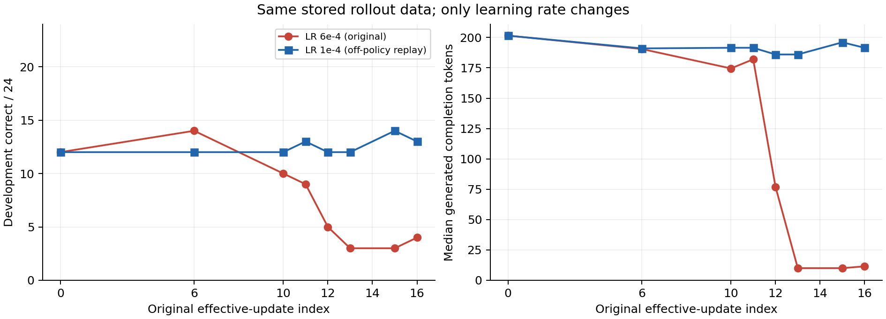

# Narl 实验报告

在 Apple M2（8 GiB）上测量权重切换时的 KV 重算、同样本重分组、异步吞吐、达标时间和 rollout 调度。CPU 实验使用 19,424 或 113,088 参数的 FP32 Llama，GSM8K 试跑使用 Qwen2.5-0.5B-Instruct。上游为 nanoRL `793e9b5`，保留 MIT 许可。实验 A、C 的源码为 `de59470`，实验 B 为 `139b90c`。运行配置、快照哈希、随机种子、模型和软件版本随原始结果保存。环境为 Python 3.11.15、PyTorch 2.8.0、Transformers 4.57.6。[复跑入口](README.md) · [完整依赖版本](runs/requirements-cpu-resolved.txt) · [主机记录](runs/cpu-host.txt)

## A. 权重切换后重算 KV

每次固定同一个历史，G=8，已经缓存的分支后缀为 16 token。第 17 个 token 由旧策略采样，权重切换后作为首个 decode 输入。旧快照为初始权重，新快照来自 12 步同步 GRPO。每个配置预热 3 次并测量 15 次。恢复时间从开始恢复到首个 logits，权重加载单列。

| Prompt tokens | 保留旧 KV，ms | 逐条重算，ms | 共享 prompt 重算，ms | 保留旧 KV 平均 KL，nats |
| ---: | ---: | ---: | ---: | ---: |
| 32 | 0.426 [0.351, 0.446] | 1.925 [1.644, 2.108] | 2.668 [2.313, 3.247] | 0.002014 |
| 128 | 0.568 [0.474, 0.602] | 7.118 [6.669, 8.178] | 3.853 [3.368, 4.354] | 0.002017 |
| 384 | 0.926 [0.746, 1.024] | 49.224 [45.118, 51.034] | 10.020 [8.973, 12.115] | 0.002436 |

括号为最小值和最大值。KL 为逐条重算分布到候选分布的方向，沿相同的 teacher-forced 历史测量。共享重算在 384-token 配置将恢复耗时降低 79.6%，32-token 配置则更慢。共享路径只重算一次 prompt，分支后缀各自重算，物理复制 prompt KV 的耗时已包含在恢复时间中。

同权重缓存与完整前向对齐。共享与逐条重算的最大 logits 误差为 `1.19e-7`，192 个位置的贪心预测一致。用相同的独立随机数实际采样，两条路径的 192 个 token 一致。测试还覆盖左 padding、位置偏移、EOS 后的统计屏蔽和分支隔离。[汇总](runs/kv-replay-release/summary.json) · [原始耗时](runs/kv-replay-release/timings.csv) · [固定输入](runs/kv-replay-release/inputs.json) · [图表](runs/kv-replay-release/replay.png)

## B. 同一批 completion 按版本重分组

使用一个真实 GRPO 训练轨迹的五个检查点，每个 prompt 从两份权重各采 8 条。比较两个同版本组与两个各含 4 新 4 旧的组。两臂共享全部 completion ID、token、mask、行为 logprob 和 reward，重分组后按 ID 对齐 advantage，随后用相同 learner 和 loss 分母计算梯度。16 个 prompt、3 个采样种子、每种子 8 次重分组，共 2,304 条唯一 completion、120 个配对比较。同权重对照使用独立采样流。

| 快照对 | 共同历史上的平均 KL，nats | 平均绝对 advantage 变化的中位数 | 梯度余弦中位数 | 零信号组比例中位数，同版 → 混版 |
| --- | ---: | ---: | ---: | ---: |
| v4 / v32 | 0.1062 | 0.249 | 0.963 | 34.4% → 28.1% |
| v12 / v32 | 0.1153 | 0.235 | 0.975 | 28.1% → 25.0% |
| v24 / v32 | 0.0852 | 0.231 | 0.984 | 21.9% → 21.9% |
| v31 / v32 | 0.0030 | 0.219 | 0.981 | 18.8% → 25.0% |
| v32 / v32 | 0 | 0.232 | 0.975 | 21.9% → 25.0% |

三对较高漂移快照中，每个种子内相对配对同权重对照的 advantage 变化中位数均为正，范围为 0.004–0.054。低漂移对接近同权重对照。各条件的变化范围有重叠，梯度余弦也随重分组而变。这个结果来自一条训练轨迹，支持区分重分组本身的波动和策略漂移，尚无单调的滞后效应。两次运行的 completion、分组、训练 trace 和 prompt 文件逐字节一致。[汇总](runs/regroup-release/summary.json) · [样本](runs/regroup-release/completions.jsonl) · [配对明细](runs/regroup-release/pairs.jsonl) · [图表](runs/regroup-release/regroup.png)

## C. 真实双进程在线对照

实验 A 两条重算路径通过数值对齐，因此选择逐条重算与共享 prompt 重算做在线主对照。actor 和 learner 各一个 CPU 进程，各一条 PyTorch 计算线程。每个 arm 固定队列容量 2、一个已发布快照槽、发布频率每个准入组一次、滞后上限 1。两臂对每个种子使用相同初始权重、训练 prompt 流和 18,432 个生成 token 的预算，保留自由采样。生成长度按 16、24、32 token 循环，奖励来自末 token。每四个 token 检查新权重，每组最多切换一次。正式运行前两个短跑 arm 均观察到跨版。固定输入测试核对了跨版前后逐 token 行为 logprob、token、reward 和恢复计算量。[短跑](runs/kv-online-swap-pilot/summary.json) · [固定换版测试](tests/test_narl_kv_online.py)

| 种子 | 换版恢复中位数，ms | 有 advantage 的训练 tokens/s | 消费组/s | 过期丢组 | 最终留出 reward |
| ---: | ---: | ---: | ---: | ---: | ---: |
| 0 | 7.89 → 3.79 | 1575 → 1646 | 14.21 → 14.08 | 18 → 21 | 0.25 → 0.25 |
| 1 | 7.56 → 3.86 | 1723 → 1622 | 15.72 → 14.91 | 16 → 16 | 0.25 → 0.25 |
| 2 | 7.42 → 3.90 | 1708 → 1650 | 16.80 → 17.18 | 11 → 16 | 0.25 → 0.25 |

箭头为逐条重算到共享重算。墙钟含 actor 启动、评估和写日志。共享重算的每种子恢复时间快 1.90–2.08 倍，端到端训练 token 吞吐的配对差异为 −101 到 +71 token/s，方向不一致。六个运行起点和终点的留出集 reward 均为 0.25，seed 1 的两臂早期曾跌到 0。该任务和预算下未观察到学习收益。

三种子记录了 371 次在途换版。版本号在每个准入组后递增，包括梯度为零的发布。逐组 trace 中，202 次在途切换跨过至少一个非零梯度更新，其中 109 次所在的组实际被消费。所有消费组的 lag 都在 0–1，98 个过期组被拒绝。审计核对了 token 预算、行为版本、准入、丢组、固定评估记录及每次权重切换。生成吞吐、有效组吞吐、零信号比例、排队和更新耗时、消费组与丢弃组的长度及 reward 分布保存在审计结果。压力运行分别观察到最长约 1.86 秒和 0.16 秒的 producer put，两个 arm 各拒绝 4 个过期组。另以相同队列、快照槽和发布频率运行 `τ=2` 的短对照，实际消费了 lag 2 的组。[正式配置](runs/online-release/protocol.json) · [正式审计与分布](runs/online-release/audit.json) · [学习和吞吐图](runs/online-release/online.png) · [压力审计](runs/online-backpressure/audit.json) · [τ=2 审计](runs/online-tau2/audit.json)

## D. 共享 actor 与 learner 的 prompt 计算

实验 C 的改动只覆盖换版恢复。扩展版在 actor 开始生成时也只对同组 prompt 做一次 prefill，换版后按同样方式重算。在 learner 评分时，八条 completion 共用一次带梯度的 prompt 前向。各分支的梯度通过复制的 KV 回传到同一份前缀计算。两项单元测试将逐 token logprob 和所有参数梯度与逐条评分对齐。actor 的固定换版测试同时验证初始共享前缀下的采样 token、实际行为 logprob 和版本跨度。

在同一台 Apple M2 上，保留实验 C 的 prompt 长度、组大小、生成长度、固定评估集、线程预算、队列容量和滞后阈值。将每臂预算扩展到 384 组（73,728 个生成 token），跑五个配对种子，交替安排执行顺序。对照组在 actor 初始 prefill、换版恢复和 learner 评分时均逐条处理 prompt。优化组在这三处均共享。墙钟包含 actor 启动、评估和日志。源码为 `da12a51`。[运行配置](runs/online-prefix-5seed/protocol.json) · [审计与各阶段分布](runs/online-prefix-5seed/audit.json)

| 种子 | 墙钟，秒 | 有非零 advantage 的已接收 tokens/s | 提升 | 过期丢组 |
| ---: | ---: | ---: | ---: | ---: |
| 0 | 12.96 → 10.64 | 2,875 → 4,487 | 56.1% | 91 → 15 |
| 1 | 13.16 → 10.11 | 3,322 → 4,791 | 44.2% | 45 → 22 |
| 2 | 13.46 → 9.75 | 2,881 → 4,196 | 45.6% | 50 → 19 |
| 3 | 13.01 → 9.69 | 2,799 → 4,702 | 68.0% | 88 → 22 |
| 4 | 14.39 → 12.03 | 2,717 → 3,696 | 36.0% | 66 → 26 |

端到端吞吐增益的配对中位数为 **45.6%**，五个种子的范围为 **36.0–68.0%**。全部已接收 token/s 的配对中位增益为 50.6%。五个种子合计过期丢组从 340 降到 104。各臂的种子中位数再取中位，actor 初始 prefill 从 6.11 ms 降到 1.23 ms，有非零 advantage 的 learner 更新从 17.43 ms 降到 7.89 ms。在线增益归属于三处共享的组合。十次运行的最终留出集 reward 均为 0.25，测量只覆盖本机小模型和合成任务。吞吐分子为非零 advantage 已接收组中的 completion token 数，逐 token 梯度仍受 loss clipping 影响。[在线图表](runs/online-prefix-5seed/online.png) · [原始运行汇总](runs/online-prefix-5seed/summary.json)

## E. 达到同一留出准确率的时间

在同一台 Apple M2 上训练 19,424 参数的 Llama，让模型把四种已知查询 token 分到两个类别。320 个训练 prompt 和 64 个留出 prompt 各自类别平衡。留出集包含 4 种未在训练中出现的干扰词与查询组合，每种有 16 个不同填充串。试跑使用另一干扰词、另一批填充串和种子 100、101。正式实验固定种子 0–4，每臂 384 组、36,864 个生成 token。prompt 长度为 128，每组八条 completion，长度按 8、12、16 token 循环。只有第一个 token 计奖励和梯度，后续 token 产生异步生成和换版负载。源码为 `2991d57`。[独立试跑](runs/learning-pilot-04/summary.json) · [冻结协议](runs/learning-5seed/protocol.json) · [留出集](runs/learning-5seed/heldout.json)

以第二次连续达到至少 75% 留出准确率的评估作为达标点，两次评估对应不同的 learner 更新步。对照每条 completion 独立处理 prompt，优化组在初始生成、换版和 learner 评分时共享 prompt 计算。所有运行使用同一份初始权重。每对种子共享训练 prompt 顺序、采样随机流和生成预算。墙钟包含 actor 启动、训练、期间评估及写日志。达标 token 数包含截至该评估时 actor 已完成的整组生成，包括排队中的组。

| 种子 | 达标时间，逐条 → 共享 | 达标时完整生成 token，逐条 → 共享 | 固定预算总耗时降幅 |
| ---: | ---: | ---: | ---: |
| 0 | 3.595 → 3.851 s | 6,688 → 5,184 | 13.6% |
| 1 | 4.123 → 3.823 s | 6,912 → 5,248 | 20.8% |
| 2 | 4.324 → 4.089 s | 9,664 → 10,144 | 21.6% |
| 3 | 3.847 → 2.893 s | 6,784 → 5,056 | 25.0% |
| 4 | 3.957 → 3.313 s | 6,688 → 5,184 | 28.2% |

十次运行均从 0% 提升到 100%，并通过 75% 达标规则。共享组的达标耗时配对中位数缩短 **7.3%**（4/5 更快），达标所需的完整生成 token 配对中位数减少 **1,504 个**（4/5 更少）。固定生成预算的总耗时配对中位数缩短 **21.6%**（5/5 更快），有非零 advantage 的答案 token/s 配对中位数提高 28.5%。这项实验测量小模型在短答案合成任务上的达标时间，奖励 token 在首次换版检查之前生成。[正式汇总及配对结果](runs/learning-5seed/summary.json)

## F. 按权重版本调度 rollout

三个 actor 和一个 learner 各用一条 PyTorch 计算线程。每组八条 completion，长度按 8、24、64 token 循环。所有实验臂使用同样的前缀共享、队列容量 2、滞后上限 1 和每次准入后发布一次权重的规则。每个种子三臂生成相同的 384 组，共 98,304 个 token，按派发 ID 配对 prompt、生成长度和采样随机流。试跑用独立种子 81、82 在 1–5 组的 FIFO 窗口里选出有效 token/s 最高的单组窗口。正式实验也保留两组窗口的 FIFO，跟版本感知调度在相同窗口下比较。正式源码为 `9007385`。[FIFO 调参结果](runs/dispatch-tune-a/summary.json) · [正式协议](runs/dispatch-5seed-frozen/protocol.json)

版本感知调度在派发前为每组保留版本余量。只要上一组已落后一个版本，新组就等到上一组被 learner 处理后再启动。learner 仍以组内最旧的实际采样版本做最终准入判断。计时包含 actor 启动、生成、训练和写日志，固定留出集评估在计时区间外。

| 调度 | 有非零 advantage 的 token/s 中位数 | 全部已接收 token/s 中位数 | 过期丢组 | 过期 token | 已接收组 p95 延迟中位数 | 每次运行 actor 等待派发时间之和的中位数 |
| --- | ---: | ---: | ---: | ---: | ---: | ---: |
| FIFO，单组在途 | 4,158 | 6,272 | 0 | 0 | 61.8 ms | 26.1 s |
| FIFO，两组在途 | 2,136 | 3,203 | 605 | 309,760 | 59.1 ms | 9.9 s |
| 版本感知，两组在途 | 3,928 | 6,137 | 0 | 0 | 87.3 ms | 23.0 s |

相对两组 FIFO，有非零 advantage 的 token/s 配对中位数提高 **84.6%**，五个种子均提高。两组 FIFO 丢弃的 605 组全部是 64-token 长组，占这档长度的 605/640。版本感知调度消费了每一组，因此 p95 基于包含更多长组的样本。固定预算墙钟中位数为 16.02 s，两组 FIFO 为 11.29 s。相对调过的单组 FIFO，有非零 advantage 的 token/s 配对中位数提高 **4.3%**，范围为 −10.2% 至 +12.0%，五个种子中三个提高。全部已接收 token/s 配对中位数下降 2.2%。15 次运行的最终留出 reward 均为 0.25。此结果适用于固定长度分布和单版本滞后上限下的 CPU 合成负载。[正式汇总](runs/dispatch-5seed-frozen/summary.json) · [逐组审计](runs/dispatch-5seed-frozen/audit.json)

首轮测量期间，共用的在线模块因学习实验增加了接口，因此以冻结提交复跑作为正式结果。首轮相对单组 FIFO 的有效 token/s 配对中位增幅为 22.5%，高于冻结版复跑的 4.3%。同窗口的两组 FIFO 在两轮中分别丢弃了 606 和 605 组，版本感知调度两轮均无丢组。[首轮结果](runs/dispatch-5seed/summary.json)

## G. 每次更新两组时，长题的达标时间

在 CPU 上训练模型根据查询词生成交替二进制序列，短题 3 token，长题 12 或 16 token。训练按整段逐位置正确率给奖励，留出评估要求整段完全匹配。训练有 320 个上下文。64 个留出上下文的干扰词与填充串在训练中均未出现，每档长度的两种相位均衡。任务只有两种答案相位，测量的是已见规则在新上下文下的学习。两个独立开发种子的同步试跑在 128 个生成组时都从 0% 学到了长短两档 100%。[任务代码](experiments/kv_sequence_task.py) · [开发试跑](runs/sequence-pilot-01/summary.json)

异步开发实验用种子 120、121 比较 FIFO 的 1–4 组在途窗口，窗口 2 的两次长题达标时间都最短。额外用种子 122、123 验证同为窗口 2 时，两臂均能达标，且 learner 确实用到了非零 advantage 组里换版后生成的长题 token。正式五种子使用冻结源码 `6622853`，同一份初始权重，每臂三个单线程 actor、一个单线程 learner、两个在途位和两个 learner 待更新位。每个 optimizer step 消费两个完整组，随后发布一次权重。两臂前缀共享相同，以组内最旧行为版本约束滞后至多一版。两臂每对种子使用同样的 512 个生成组、prompt 顺序、采样随机流及 token 预算。[FIFO 调参](runs/sequence-tune-01/summary.json) · [同窗口异步试跑](runs/sequence-tune-02/summary.json) · [正式协议](runs/sequence-5seed/protocol.json)

FIFO 按完成到达顺序取样，超龄组被拒收，单个剩余组不足以触发更新。版本感知调度在生成前给组预留截止前的 learner 名额，若处理刚完成的组会挤掉老组的名额，则先等老组。正式主指标为长题留出准确率连续两次至少 75% 的第二次评估完成时间，两次对应不同的 optimizer 版本。每收到 32 组评估一次，墙钟包含进程启动、生成、训练、评估和日志。等量组数的检查点所含长短组比例及 token 数可因完成顺序而异。

| 种子 | FIFO 达标时间 | 版本感知达标时间 | 耗时降幅 | 达标时完整生成 token，FIFO → 版本感知 |
| ---: | ---: | ---: | ---: | ---: |
| 0 | 4.577 s | 4.550 s | +0.57% | 6,736 → 6,736 |
| 1 | 5.141 s | 5.456 s | −6.12% | 8,992 → 7,120 |
| 2 | 4.542 s | 5.104 s | −12.35% | 6,056 → 6,056 |
| 3 | 6.054 s | 5.332 s | +11.92% | 9,032 → 9,032 |
| 4 | 5.983 s | 4.975 s | +16.86% | 7,816 → 7,816 |

两臂 5/5 达标，十次运行长短两档最终准确率均为 100%。长题达标耗时配对中位数缩短 **0.026 s（0.57%）**，五个种子里三个更快，未达到 4/5 的继续投入门槛。达标时完整生成 token 的配对中位差为零。合计 1,272 个长组，FIFO 消费 1,036 个、过期 234 个、剩余未凑成整批 2 个，版本感知调度消费全部 1,272 个。两臂均消费全部 1,288 个短组。核对逐组 loss 后，有非零 advantage 的换版后长题 token 从 4,992 增至 9,784。独立审计重算了样本预算、行为版本、奖励、两组更新及达标统计，留出准确率来自保存的评估记录。[正式汇总](runs/sequence-5seed/summary.json) · [独立审计](runs/sequence-5seed/independent-audit.json)

## H. 权重实际变化才升版

复跑 G 的五个种子、CPU 任务、512 组生成预算和 75% 长题达标规则。每次更新仍消费两个完整组，FIFO 和版本感知调度的在途窗口均为 2，准入允许的权重滞后仍为一版。learner 比较 optimizer step 后的 FP32 参数字节与当前已发布快照。字节改变时才复制快照并升版。训练批次另行计数，达标仍要求连续两次评估且来自不同训练批次。两臂在计时中都执行相同的比较和哈希记录，最终快照文件在计时后写入。源码为 `095bd1a`。[复跑协议](runs/sequence-changed-5seed/protocol.json)

| 种子 | FIFO 过期长组 | FIFO 达标时间 | 版本感知达标时间 | 耗时降幅 |
| ---: | ---: | ---: | ---: | ---: |
| 0 | 4 | 6.141 s | 6.494 s | −5.74% |
| 1 | 4 | 6.507 s | 6.511 s | −0.06% |
| 2 | 1 | 4.181 s | 5.358 s | −28.16% |
| 3 | 7 | 5.898 s | 5.449 s | +7.60% |
| 4 | 3 | 5.670 s | 4.978 s | +12.21% |

**FIFO 的过期长组从 234/1,272 降到 19/1,272（18.4% → 1.5%），版本感知调度仍为 0。** FIFO 还有 1 个合格长组在收尾时未凑成整批，两臂实际用于更新的长组分别为 1,252 和 1,272。新规则分别让 FIFO 的 726 个批次和版本感知调度的 773 个批次保留原权重版本。这些批次都跳过了两组的反传，审计核对了版本、参数哈希链和最终快照。

两臂均 5/5 达标，十次运行的长短题最终均为 100%。同轮配对比较中，版本感知调度只有 2/5 更快，达标耗时中位差为 **慢 0.004 s（0.057%）**，仍未达 4/5 门槛。要求两个评估点对应不同权重版本时，所有达标结果相同。达标时完整生成 token 的配对中位差为零，其中两个种子分别少生成 4,232 和 4,408 个。墙钟包含 actor 启动，首组到达时间跨运行波动为 3.18–5.37 s，因此耗时使用复跑内的配对结果，旧轮只用来对照过期数量。[复跑汇总](runs/sequence-changed-5seed/summary.json) · [独立审计](runs/sequence-changed-5seed/audit.json)

调度实验在此收尾。后续实验以按实际权重变化升版的 FIFO 为基线。版本感知调度保留为有界滞后的参考实现。若后续任务在达标前持续丢弃长样本，并出现对应的学习差异，再用该负载复验调度。

## I. 两位数加法上的共享前缀

在同一台 Apple M2 上，用 113,088 参数的三层 Llama 做两位数加法。输入将个位和十位分别成对排列，输出三位十进制数，低位在先。3,200 个训练题、128 个开发题、128 个正式留出题按无序操作数对隔离。各集合的个位进位题与不进位题各占一半。输入补到 128 token，生成固定三位数字，整题正确得 1 分。两臂共用同一个只在训练题上做过 1,380 步 SFT 的检查点。[任务代码](experiments/kv_arithmetic_task.py) · [SFT 开发曲线](runs/arithmetic-sft-03/sft-curve.json)

同步开发种子 130、131 用整题奖励继续做 GRPO，在第 192 组时均已连续两次超过 70%，分别从 63.3% 到 71.9% 和 76.6%。随后用异步开发种子 132 核对两臂，两边均在第 192 个已接收组确认达标。开发试验中的逐位奖励未带来稳定的整题准确率提升，正式比较使用整题奖励。[同步开发 130](runs/arithmetic-exact-1380/grpo-130.json) · [同步开发 131](runs/arithmetic-exact-1380/grpo-131.json) · [异步开发对照](runs/arithmetic-online-dev-final/audit.json)

正式实验锁定种子 0–4、每臂 768 个生成组（18,432 个答案 token）、每 96 个收到的组评估一次。总体准确率连续两次达到 70% 时，以第二次评估完成为达标时点。两臂使用相同的 FIFO 窗口 2、每步两个完整组、实际变化才升版及滞后上限一版。逐条臂只投影参与 loss 的 logits。共享臂在 actor 初始 prefill 和 learner 评分时各复用一次组内 prompt 计算。三 token 答案在首次在途换版检查前结束。主要记录 actor 就绪后的墙钟，同时保留含 actor 启动的计时，两个口径均包含期间评估。源码为 `4e9aeb5`。[正式协议](runs/arithmetic-prefix-5seed/protocol.json)

| 种子 | 达标时已收到的组 | 就绪后达标时间，逐条 → 共享 | 从 actor 启动到达标，逐条 → 共享 | 最终总体准确率，两臂相同 |
| ---: | ---: | ---: | ---: | ---: |
| 0 | 192 | 7.84 → 3.00 s | 13.37 → 6.94 s | 82.8% |
| 1 | 192 | 8.52 → 3.02 s | 12.51 → 7.00 s | 85.9% |
| 2 | 192 | 5.96 → 2.33 s | 9.94 → 5.74 s | 78.9% |
| 3 | 288 | 8.27 → 3.43 s | 11.69 → 7.87 s | 85.2% |
| 4 | 192 | 5.54 → 2.59 s | 8.82 → 6.65 s | 82.0% |

共享前缀在 5/5 对中更快。actor 就绪后达标耗时的配对中位降幅为 **60.9%**，配对节省时间的中位数为 **4.84 s**。计入 actor 启动时，配对中位降幅为 **42.3%**。两臂用相同数量的完整生成 token 确认达标，四对各用 4,656 token，一对用 6,960 token。跑完固定生成预算的总耗时配对中位降幅为 58.2%（从就绪计时）和 50.9%（从 actor 启动计时）。[正式汇总](runs/arithmetic-prefix-5seed/summary.json) · [独立审计](runs/arithmetic-prefix-5seed/audit.json)

五对的 45 个总体准确率评估点全部一致，从 63.3% 起步，最终为 78.9%–85.9%。两臂都消费了所有生成组。四对的采样 token 逐组一致，第五对有 13/768 个组的采样 token 不同，最终参数字节在五对中均有差异。组 prefill 的种子中位数再取中位为 13.80 → 2.74 ms，带训练信号的 learner 更新为 54.64 → 19.51 ms。加速测量覆盖这台 CPU 上带填充前缀的三位数输出和小模型。[阶段耗时及轨迹配对](runs/arithmetic-prefix-5seed/phase-analysis.json)

## J. 前缀长度与输出长度的影响

在 Apple M2 上用单线程 PyTorch、113,088 参数的 FP32 Llama 和每组 8 条答案，交叉测量 7 种前缀长度（8–384 token）和 4 种输出长度（3、16、64、128 token）。每种配置每条路径预热 3 次，交替运行并记录 15 次。生成端使用固定权重和相同 token 历史，计 prefill 与缓存解码。训练端计答案 logprob 和反向传播，两臂都只投影答案所需的 logits。每个点的加速比为逐条计算耗时中位数除以共享耗时中位数。源码为 `90d7fad`。

| 前缀 / 输出 token | 生成端加速 | 训练端加速 |
| --- | ---: | ---: |
| 8 / 16 | 1.03× | 0.97× |
| 32 / 128 | 1.00× | 1.15× |
| 128 / 3 | 2.99× | 2.85× |
| 128 / 16 | 1.49× | 2.57× |
| 128 / 64 | 1.12× | 1.99× |
| 128 / 128 | 1.06× | 1.59× |
| 384 / 128 | 1.34× | 2.58× |

固定 128-token 前缀时，输出越长，初始 prefill 占生成时间的比例越小，生成端加速趋近 1×。短前缀的几个点接近持平，8/16 和 16/16 的训练端耗时略有回退。28 点的生成 logits、训练 logprob 和 embedding 梯度最大绝对误差分别为 `1.79e-7`、`4.77e-7` 和 `1.19e-7`。[完整曲线](runs/prefix-length-cpu-final/speedup.png) · [实验协议](runs/prefix-length-cpu-final/protocol.json) · [逐点结果](runs/prefix-length-cpu-final/summary.json) · [原始计时](runs/prefix-length-cpu-final/timings.csv)

实验 A 的 32-token 回退发生在换权重后恢复 KV，测量区间与本节的固定权重生成不同。实验 D 的 45.6% 来自 128-token 输入、16/24/32-token 输出的在线训练吞吐。实验 I 的 60.9% 来自 128-token 输入、3-token 输出的达标墙钟，起点为 actor 就绪。CUDA 固定历史对照与 vLLM 基线见[复跑方案](docs/gpu-validation.md)。

## K. GSM8K 上的版本混组试跑

先在 Apple M2 CPU 上用 FP32 Qwen2.5-0.5B-Instruct 从 GSM8K 官方训练集随机抽题，每题采 4 条，最多生成 128 token。用 `<answer>` 内的数值计分。受本机内存压力影响，计划的 16 题完成了 13 题。52 条答案中 6 条得分，22 条有完整答案标签，2 条生成达到上限。13 组中有 4 组同时出现对错答案，可以产生非零 GRPO advantage。[筛选汇总](runs/gsm8k-signal-cpu/partial-summary.json) · [生成记录](runs/gsm8k-signal-cpu/groups.jsonl)

在同一台机器上用 MPS BF16 生成这 4 道训练题的答案，用 CPU FP32 做 GRPO 更新。旧快照为原模型加零输出 LoRA，新快照在另外 8 道训练题上做监督更新，LoRA 仅覆盖最后 4 层的 Q、V 投影。每题从旧快照采 4 条，从新快照独立采两批各 4 条。旧新对照的两臂均从同一新快照起步，每题用相同 8 条 completion 和逐 token 行为 logprob 做一步更新。一臂按版本分两组，另一臂每组各含 2 条旧样本和 2 条新样本。另用新快照的两批独立样本重复这组操作，测同版本随机重分组的影响。评估使用固定抽样的 8 道官方测试题。[复跑命令](docs/gpu-validation.md#reproduce-the-local-pilot)

| 配对对照 | 每臂训练 token | advantage 改变的答案 | 平均绝对 advantage 变化 | 有非零 advantage 的 token |
| --- | ---: | ---: | ---: | ---: |
| 按版本分组 → 新旧混组 | 692 | 8/32 | 0.125 | 345 → 341 |
| 同版本分组 → 同版本打乱 | 642 | 20/32 | 0.296 | 281 → 563 |

四臂各有 3 步非零梯度。起始检查点及四臂的最终留出成绩均为 **0/8**。首轮 MPS BF16 反传出现非有限梯度，表中训练结果来自同一组已保存样本和 adapter 的 CPU FP32 复跑。这个单种子试跑测到了分组对训练信号的影响。要判断学习效果，需要先在独立开发集获得非零起始分数，再扩大训练与留出预算。在线过期样本的独立效应仍待测量。[独立审计](runs/gsm8k-regroup-local-fp32/audit.json) · [协议](runs/gsm8k-regroup-local-fp32/protocol.json) · [训练与评估记录](runs/gsm8k-regroup-local-fp32/summary.json) · [原始样本](runs/gsm8k-regroup-local-fp32/samples.jsonl)

## L. GSM8K 开发集验收与同预算分组对照

复查原来的 8 道题，6 条有完整标签但数值错误，2 条没有完整标签且给出的最后数值也错。7 条在 4–13 token 内自行结束，只有 1 条用满 128 token。放宽标签后仍为 0/8，起始模型与四个训练臂的答案逐 token 相同。[逐题诊断](runs/gsm8k-zero-diagnosis/summary.json)

在原版 Qwen2.5-0.5B-Instruct 上，用 Apple M2 的 MLX BF16 在预先抽出的 24 道 GSM8K 训练集开发题做验收。监督训练题、GRPO 采样题、开发题和正式测试题互不重叠。用相同推理提示、256-token 上限及带标签数值精确匹配，选择首个比起始模型至少多答对 3 道的检查点。

| 开发集条件 | 答对 / 24 | 有完整答案标签 | 达到生成上限 |
| --- | ---: | ---: | ---: |
| 原提示，128 token | 1 | 18 | 1 |
| 原提示，256 token | 1 | 18 | 1 |
| 推理提示，训练前 | 3 | 4 | 14 |
| 同一推理提示，SFT 16 步 | 3 | 3 | 13 |
| 同一推理提示，SFT 40 步 | 5 | 13 | 11 |
| 同一推理提示，SFT 80 步 | 9 | 16 | 11 |

80 步检查点通过验收。带标签精确匹配从 3/24 到 9/24。作为开发集敏感性检查，若对无标签且正常结束的答案也取最后一个数字，分数为 8/24 → 9/24。这一轮可确认模型对提示和答案格式的适配，数学能力的独立增益仍难从 24 道题判断。[开发记录](runs/gsm8k-dev-mlx-final/development.json) · [验收文件](runs/gsm8k-dev-mlx-final/dev-qualified.json)

正式对照固定同一批 16 道训练题。每题从初始权重和 80 步检查点各生成 4 条，共 128 条。每臂从 80 步检查点起步，每题消费 8 条并尝试一步 GRPO 更新，四组各 2 条。按版本分组保留原来的同版本组。新旧混组在各组内配对一新一旧。同版本打乱在各自版本内交换同等数量的组员。三臂的 completion ID、生成 token、行为 logprob 和累积顺序完全相同。固定 32 道官方测试题，排除此前试跑检查过的 9 道题。该设计测固定样本如何分组，旧样本来自监督训练前的快照，在线发布间隔的效应需另测。

旧、新快照各采 64 条。两者分别答对 2 条和 11 条，完整标签分别为 4 条和 42 条，触及 256-token 上限分别为 49 条和 21 条。各臂都消费同一份包含 **27,877 个 completion token** 的样本池。[冻结协议](runs/gsm8k-matched-mlx-final/protocol.json) · [采样记录](runs/gsm8k-matched-mlx-final/samples.jsonl)

| 设置 | 正式留出答对 / 32 | 非零 advantage token | 非零梯度更新 |
| --- | ---: | ---: | ---: |
| GRPO 前 | 11 | — | — |
| 按版本分组 | 10 | 4,054 | 6/16 |
| 新旧混组 | 11 | 3,610 | 5/16 |
| 同版本打乱 | 12 | 1,642 | 4/16 |

对照按版本分组，新旧混组只多答对 1 道（1 胜 0 负），同版本打乱多答对 2 道（2 胜 0 负）。对照 GRPO 前，新旧混组在逐题正误上全部相同。三臂两两配对的精确 McNemar p 值为 0.5–1.0。新旧混组和同版本打乱分别改变了 26/128 和 18/128 条答案的 advantage。这个单种子实验确认分组会改动训练信号。留出集只观察到一两题的差异，尚无稳定学习增益证据。[独立审计](runs/gsm8k-matched-mlx-final/audit.json) · [逐题评估与更新记录](runs/gsm8k-matched-mlx-final/summary.json) · [复跑入口](docs/gpu-validation.md#reproduce-the-matched-budget-comparison-on-apple-silicon)

## M. GSM8K 在线滞后一版

用实验 L 的 80 步 SFT adapter 作为 v0。先用 v0 生成并保存的四条答案做一步 GRPO 得到 v1，再用 v1 新采四条答案，沿同一 optimizer 做一步 GRPO 得到 v2。两步均有非零梯度并改变 adapter 字节。五个种子的三臂共用 v1/v2 起点，learner 从 v2 开始，各臂重置相同的 AdamW。锚点准备与正式生成分别计量。[冻结协议](runs/gsm8k-online-lag-5seed/protocol.json) · [锚点采样](runs/gsm8k-online-lag-5seed/warmup-samples.json)

每个 seed 的三臂共用训练题顺序和采样种子规则，边生成边更新各自的 learner。每次用一题两条答案组成 GRPO 组。全新臂两条都用当前版，滞后一版臂两条都用上一个实际发布的版本，混组臂每组各用一条。只有 adapter 字节改变才升版。模型在 Apple M2 上串行切换和学习，组内混版分开解码，同版在预算允许时批量解码。每臂精确生成 6,144 个 completion token（含 EOS），按余额限制尾批，评估使用固定的 32 道新官方测试题。[复跑命令](docs/gpu-validation.md#reproduce-rolling-one-version-lag-on-apple-silicon)

| 种子 | 全新答对 / 32 | 滞后一版答对 / 32 | 新旧混组答对 / 32 | 有效更新，全新 / 滞后 / 混组 |
| ---: | ---: | ---: | ---: | ---: |
| 0 | 9 | 7 | 7 | 4 / 2 / 1 |
| 1 | 9 | 7 | 9 | 2 / 1 / 2 |
| 2 | 7 | 10 | 9 | 2 / 2 / 1 |
| 3 | 6 | 8 | 9 | 6 / 4 / 5 |
| 4 | 9 | 9 | 8 | 4 / 3 / 5 |

共同起点为 **6/32**。全新臂有 4/5 个种子高于起点，滞后与混组各 5/5。三个臂之间的每项对照都是 **2 胜、2 负、1 平**，配对准确率差的中位数均为 **0 个百分点**。三项种子级双侧精确置换检验的 p 值为 0.875–1.0。三臂各消费 30,720 token，有效更新合计为 18、12、14 步。混组中有 15,214/30,720 token 来自滞后一版（49.5%）。独立审计解码并重算留出题分数，重放 2 个准备更新及 242 个正式批次，核对了 44 次实际权重更新的逐步哈希。

在这 5 个种子和 32 道测试题上，未测到滞后一版或混组带来方向稳定的准确率差异。每组只有两条答案，等生成预算下各臂有效更新次数可以不同。混组与同版的解码 batch 形状也不同，共用种子允许生成轨迹分叉。本轮串行推进策略版本，结论适用于该学习对照，集群吞吐和更长滞后仍需单独测量。[配对结果](runs/gsm8k-online-lag-5seed/summary.json) · [独立审计](runs/gsm8k-online-lag-5seed/audit.json)

## N. GSM8K 留出答案损失

在线 GRPO 日志记录的是随 rollout 和行为策略变化的带符号优化目标。这里固定评估输入和目标，以每个正确答案数字 token 的负对数似然（NLL，nats/token）衡量损失。输入为题目、原推理提示和固定的 `<answer>` 开标签。评估上下文无参考推导，标签和 EOS 不计入损失。另在预先选定的 24 道题上用原提示词自由生成，按原规则计算准确率。

两臂从实验 M 的同一 v2 adapter 起步。每个种子重放全新臂原有的 6,144 个 rollout token，使用相同组、顺序和学习率。候选臂在梯度裁剪前加上正确数字的交叉熵梯度，在组内奖励一致、GRPO 无梯度时仍可更新。额外监督 token 单列。先在 48 道独立开发题上试学习率 `1e-4`、`3e-4`、`6e-4`，各筛权重 `0.1`、`0.4`、`1.0`。前两档未达到预定的 2% 开发损失降幅。第三档锁定权重 `0.1`，开发损失为 **1.7261**，起点 **1.7878**，同学习率原 GRPO **1.7903**。正式评价固定 64 道此前未检查的 GSM8K 官方测试题，两组比较均要求至少 4/5 种子下降且中位降幅至少 2%。[复跑命令](docs/gpu-validation.md#reproduce-the-gold-answer-loss-comparison) · [开发筛选 `1e-4`](runs/gsm8k-loss-5seed/development.json) · [开发筛选 `3e-4`](runs/gsm8k-loss-lr3e4/development.json) · [开发筛选 `6e-4`](runs/gsm8k-loss-lr6e4/development.json) · [正式协议](runs/gsm8k-loss-lr6e4/protocol.json)

| 种子 | 原 GRPO NLL | 加答案监督 NLL | 相对原 GRPO 降幅 | 原 GRPO → 加监督，答对 / 24 | 额外监督 token |
| ---: | ---: | ---: | ---: | ---: | ---: |
| 0 | 1.92885 | 1.85051 | 4.06% | 7 → 9 | 32 |
| 1 | 1.92211 | 1.86724 | 2.85% | 8 → 9 | 32 |
| 2 | 1.92014 | 1.86225 | 3.01% | 9 → 8 | 30 |
| 3 | 1.91552 | 1.84556 | 3.65% | 5 → 6 | 34 |
| 4 | 1.92051 | 1.88713 | 1.74% | 9 → 9 | 40 |

五个种子全部降低数字 NLL。相对原 GRPO 的配对降幅中位数为 **3.01%**（1.74%–4.06%），相对共同起点 **1.92022** 为 **3.02%**。两组比较的种子级双侧精确置换 p 值均为 0.0625。候选每个种子有 14–17 步非零梯度，原 GRPO 有 2–6 步。自由生成对比原 GRPO 有 3 个种子升、1 个降、1 个持平，共同起点为 8/24。这个增益对应附加答案监督的固定样本重放和指定开标签后的数字预测。自由生成准确率暂未观察到稳定提升。审计重新前向计算了全部 11 份权重在 64 道题上的损失，重放 158 个训练批次并核对正式终点权重哈希。[独立审计](runs/gsm8k-loss-lr6e4/audit.json)

## O. GSM8K 自由生成准确率

在实验 N 的五个原 GRPO 检查点上继续 LoRA 监督训练。候选沿用原 GRPO 的同一权重、样本和优化历史，每个种子每臂均使用 **6,144 个 rollout token**。候选额外训练官方训练集中的参考推导、最终答案和 EOS。参考推导移除数据集的计算器标记，标签监督 token 单独计数。两臂用同一推理提示、256-token 上限和贪心解码，模型自行生成推导和 `<answer>` 标签，再按数字精确匹配计分。

在与正式训练及测试隔离的 48 道开发题上，比较每个种子额外训练 48、128、256 条参考解答。种子 0 的原 GRPO 为 23/48，三个预算分别为 25、18、26/48。种子 1 为 17/48，三个预算分别为 18、24、24/48。256 条是唯一在两个开发种子均提升且配对中位提升至少 5 个百分点的预算。随后锁定 96 道此前未评分的官方测试题。正式门槛为至少 4/5 种子提升、配对中位增益至少 5 个百分点、同题配对 bootstrap 的 95% 区间下界大于零。[预先冻结的计划](runs/gsm8k-accuracy-v1/plan.json) · [开发记录](runs/gsm8k-accuracy-v1/development.json) · [复跑命令](docs/gpu-validation.md#reproduce-the-free-generation-accuracy-comparison)

| 种子 | 原 GRPO 答对 / 96 | GRPO 加解答监督答对 / 96 | 配对增益 | 额外监督 token | 截断数，原 GRPO → 候选 |
| ---: | ---: | ---: | ---: | ---: | ---: | ---: |
| 0 | 23 | 30 | +7.29 pp | 25,238 | 39 → 12 |
| 1 | 23 | 30 | +7.29 pp | 23,632 | 38 → 10 |
| 2 | 24 | 34 | +10.42 pp | 25,019 | 44 → 14 |
| 3 | 22 | 34 | +12.50 pp | 25,722 | 42 → 12 |
| 4 | 21 | 32 | +11.46 pp | 25,532 | 43 → 13 |

**五个种子全部提升，配对中位增益为 10.42 个百分点。** 以题目为单位、跨种子共同重采样的 95% bootstrap 区间为 **+3.13 至 +16.67 个百分点**，五种子双侧精确置换 p 值为 0.0625。作为格式敏感性检查，对没有完整标签且正常结束的输出改用末尾数字，五对正确数均不变。候选显著减少了达到输出上限的回答，端到端结果包括在预算内完成推导与答案的改善。[独立审计](runs/gsm8k-accuracy-v1/audit.json) · [正式协议](runs/gsm8k-accuracy-v1/protocol.json)

复核重新评分全部 960 条自由生成答卷，另外抽查 120 条解码并重放 1,280 个监督训练步骤，五份候选终点权重哈希一致。作为附加指标，实验 N 的数字 NLL 在同一批 96 题上有 4/5 个种子下降，配对中位降幅为 0.25%。[数字 NLL](runs/gsm8k-accuracy-v1/nll.json)

## P. GSM8K 同新增响应 token 预算对照

这轮检验实验 O 的提升是否需要 GRPO。三臂统一回到实验 L 的 80 条 SFT 检查点，从本项目尚未做过 GRPO 的权重开始，避免把经过两步 GRPO 的 v2 当作 SFT-only 起点。基础模型仍为固定版本的 Qwen2.5-0.5B-Instruct，LoRA 和推理提示不变，在 Apple M2 的 MLX BF16 后端顺序运行。这里的 SFT-only 指本项目的训练流程，基础 Instruct 模型的上游训练不在对照范围内。

每臂每个种子追加 **32,768 个响应 token**。生成的 completion token 与实际参与交叉熵的监督标签 token 各计一次，含 EOS；全零 advantage 的生成和不足完整组的末尾生成也计费。SFT 仅截短最后一条目标以用完余额。prompt 前向和 GRPO 训练回放另记，因此这不是等 FLOPs 实验。共同初始化及开发、测试推理不计入新增训练预算。

| 训练臂 | 生成 token | 监督标签 token | 新增响应 token 合计 |
| --- | ---: | ---: | ---: |
| SFT-only | 0 | 32,768 | 32,768 |
| GRPO-only | 32,768 | 0 | 32,768 |
| GRPO＋SFT | 6,144 | 26,624 | 32,768 |

同一种子的两条 GRPO 路径共享实际发生的前 6,144-token 在线训练过程。GRPO-only 沿原 AdamW 状态继续，混合臂从该前缀检查点重置 AdamW 做 SFT。SFT-only 与混合臂共用同一标签题目顺序。学习率固定采用此前独立开发得到的 GRPO `6e-4`、SFT `5e-4`。其中 GRPO 学习率来自实验 N 的固定 rollout 数字 NLL 筛选，未针对本轮较长的在线预算重新寻优；本轮比较这三种预定配方，不搜索混合比例或根据测试结果换配方。

先在新的 48 道训练集开发题上诊断两个种子，共同起点为 27/48。SFT-only 为 28、30/48，GRPO-only 为 25、18/48，混合臂为 24、26/48。开发结果不设某臂必须获胜的门槛，随后按原计划评估五个配对种子、96 道新官方测试题，排除此前检查过的全部 233 道题。**主要比较预先指定为混合臂相对 SFT-only**，另两项为次要比较。[冻结计划](runs/gsm8k-budget-5seed/plan.json) · [开发记录](runs/gsm8k-budget-5seed/development.json) · [正式协议](runs/gsm8k-budget-5seed/protocol.json) · [复跑命令](docs/gpu-validation.md#reproduce-the-equal-response-token-ablation)

| 种子 | SFT-only 答对 / 96 | GRPO-only 答对 / 96 | GRPO＋SFT 答对 / 96 | 混合臂相对 SFT-only |
| ---: | ---: | ---: | ---: | ---: |
| 0 | 34 | 23 | 32 | −2.08 pp |
| 1 | 34 | 25 | 30 | −4.17 pp |
| 2 | 28 | 24 | 33 | +5.21 pp |
| 3 | 32 | 25 | 34 | +2.08 pp |
| 4 | 35 | 13 | 36 | +1.04 pp |

共同起点为 **24/96**。SFT-only 五个种子均高于起点，配对增益中位数为 **10.42 个百分点**；GRPO-only 的中位正确数为 24，与起点相同，第 4 个种子降到 13/96。

SFT-only、GRPO-only、混合臂的五种子平均准确率分别为 **33.96%、22.92%、34.38%**。混合臂相对 SFT-only 为 **3 胜、2 负**，平均差 **+0.42 个百分点**，配对增益中位数 **+1.04 个百分点**。同题配对 bootstrap 的中位数 95% 区间为 **−5.21 至 +6.25 个百分点**；同时重采样种子和题目时，中位数区间为 **−8.33 至 +9.38 个百分点**。种子级双侧精确置换 p 值为 **0.875**。本轮没有测到混合臂稳定胜过 SFT-only，也没有证明两者等效。

次要比较中，GRPO-only 五个种子均低于 SFT-only，配对差中位数 −9.38 pp，同题 bootstrap 区间为 −17.71 至 −3.13 pp；交叉重采样中位数区间为 −23.96 至 +1.04 pp。混合臂五个种子均高于 GRPO-only，配对差中位数 +9.38 pp，同题区间为 +3.13 至 +16.67 pp。两项种子级精确置换 p 值均为 0.0625，五种子的方向一致不能替代更大规模的种子验证。

| 训练臂 | 生成 prompt token，中位数 | learner 输入 token，中位数 | 训练耗时中位数 |
| --- | ---: | ---: | ---: |
| SFT-only | 0 | 93,954 | 2.17 分钟 |
| GRPO-only | 30,706 | 10,978 | 10.75 分钟 |
| GRPO＋SFT | 5,918 | 79,468 | 3.55 分钟 |

learner 输入包括 prompt 和目标前的上下文；GRPO 全零 advantage 的样本跳过梯度计算。耗时包含生成与学习，不含评估；混合臂按实际共享前缀耗时计入自身成本。这些是在同一台共享使用的 M2 上顺序执行的描述性耗时，设备负载会变化。各种子的完整计量、生成 logprob、权重哈希及逐题输出均保存。[独立审计与配对统计](runs/gsm8k-budget-5seed/audit.json)

独立审计重新评分全部 1,872 条开发及正式答卷，核对数据隔离、精确预算和 checkpoint 哈希。进一步重播 467 个 GRPO 生成组（466 个完整 learner 批次、91 次实际权重变化）及 3,101 步 SFT，各臂重播的终点权重均与对应存档逐字节一致；另从每个种子每臂重新解码首个完整评估 batch，共 180 条答卷，token 与存档一致。种子 2 的前缀末尾确实出现 1 个不足组的 token，已计费但未用于学习。[运行日志](runs/gsm8k-budget-5seed/runner.log) · [重播日志](runs/gsm8k-budget-5seed/audit.log)

实验 O 控制的是 rollout 预算，候选多用了约 2.4–2.6 万监督 token。本轮表明，在这个小模型、固定配方和新增响应 token 预算下，额外监督本身已能产生提升；目前不能把原来的提升归因于 GRPO 的独有贡献。结论不外推到其他模型、学习率、预算分配或 CUDA 系统。

## Q. GRPO-only 退化诊断

实验 P 的种子 4 从 24/96 降到 13/96，伴随输出风格明显改变。终点有 74/96 条严格纯答案输出、64 条不超过 10 token，长度中位数从起点的 238 降到 9.5 token；96 条均有完整答案标签，只有 9 条触及长度上限。严格纯答案定义为整条输出仅含一个无嵌套的 `<answer>…</answer>` 和周边空白，多次答案标签中间夹推导的输出不计入。终点保留起点答对题中的 3 道、丢失 21 道，另答对 10 道。[原始轨迹分析](runs/gsm8k-grpo-diagnosis/trace-analysis.json)

先从同一 80-SFT 起点重播种子 4 的原始 32,768-token 轨迹。高学习率重播逐组核对原权重哈希；低学习率只从 `6e-4` 改为 `1e-4`，保留原样本、行为 logprob、顺序、奖励、G2、AdamW 和裁剪。低学习率重播属于 **off-policy 敏感性诊断**。随后预先固定一个 `1e-4` 真在线对照，用同一起点、种子、题目顺序和 32,768-token 生成预算，但从自己的当前权重重新采样。新配方只在原先未用于训练的 48 道开发题上评估，原 96 道正式测试结果保持不变。[诊断协议](runs/gsm8k-grpo-diagnosis/protocol.json) · [复跑说明](docs/gpu-validation.md#diagnose-grpo-only-drift-on-the-development-split)

| 条件 | 开发答对 / 48 | 输出长度中位数 | 严格纯答案数 |
| --- | ---: | ---: | ---: |
| 共同起点 | 27 | 195.5 token | 0 |
| 原轨迹，`6e-4` 重播 | 8 | 10 token | 28 |
| 同原轨迹，`1e-4` 重播 | 26 | 186 token | 0 |
| 重新在线采样，`1e-4`，6,144 token | 29 | 181 token | 0 |
| 重新在线采样，`1e-4`，32,768 token | 24 | 178.5 token | 0 |

**严重退化对学习率配置敏感，不能只用信号少解释。** 同一份稀疏样本只降低学习率，就从 8/48 恢复到 26/48；真在线同预算也恢复到 24/48，在这 48 道开发题上未再观察到纯答案直出。低学习率在线终点仍低于共同起点，且从 6,144 token 的 29/48 降至 32,768 token 的 24/48，因此这轮只证明减轻退化，没有证明降低学习率或增加预算能稳定带来学习增益。这里仅诊断一个故障种子，未执行新的五种子留出检验。

前 24 道固定开发题用于定位变化。高学习率从 12/24 出发，原始第 6、10、11、12、13、15、16 次有效更新后，分别为 14、10、9、5、3、3、4/24。下降在多次更新中累积，不能把某一次最大梯度当成唯一触发点。



在固定的 12 道开发 prompt 上，仅测首个生成位置的完整词表参考 KL，高学习率终点均值为 2.4489 nats，低学习率重播为 0.00964，低学习率真在线为 0.00523。直接生成开标签 `<answer>` 的平均概率从起点的 0.167% 变为高学习率的 84.3%，低学习率重播和真在线分别为 1.06%、0.452%。这些是起始位置的风格漂移探针，不是整段生成 KL。高学习率单步更新后，训练样本 token 的概率比值超出 `[0.8,1.2]` 的比例中位数仅 0.456%、最大 3.5%；证据不支持“大面积单步爆炸”或 clipping 实现错误。

当前 learner 每次只用一题两条答案做一步 AdamW，没有相对共同起点的 KL 惩罚或累计漂移上限。更新前的 `akl` 和 `clipfrac` 不能证明相对起点的累计变化受到控制；原 `entropy` 字段也是采样 token 的平均负 logprob，不是完整词表熵。实验 P 的 `6e-4` 来自旧离线数字 NLL 配方，直接迁移到更长的在线训练，配置验收不足。原对照仍是三种固定配方的实测，不应解释为 GRPO 最佳能力的对照。

**信号稀疏也确实存在。** 五个原始种子只有 91/467 组产生实际权重变化，30,644/163,840 个生成 token 带非零 advantage（18.70%）。种子 4 的 131 组中，112 组全错、3 组全对，仅 16 组可更新，有效 token 占 13.99%。最后一次权重更新后的 66 条采样全部奖励为零。低学习率真在线有 23/89 次实际更新，非零 advantage token 为 7,375/32,768（22.51%），但开发准确率仍未超过起点。尚未进行组大小、梯度累积或更大预算的独立对照，不能据此断言加 token 必然有效。

奖励只检查最后一个完整答案标签中的数值。原始正样本中可见整条长 256 token、正确标签后夹有无关 XML 的输出仍获奖励 1，整条序列都获正 advantage；按序列平均的损失还使短样本的每个 token 权重更集中。这些是可能放大风格偏移的条件，本轮未单独消融奖励或长度归一化，不能称作已证明的唯一根因。

独立审计重算 624 条新开发答卷和严格纯答案计数，核对高学习率各检查点的原始权重哈希，并重播低学习率在线的全部 89 组、23 次实际权重变化，逐组哈希及终点权重一致。探针 KL 已保存并做数值范围检查，未独立再次前向重算；低学习率离线重播也未再独立重放一遍。另有纯答案分类回归测试，能捕获多标签夹推导被误计为纯答案的问题。[审计](runs/gsm8k-grpo-diagnosis/audit.json)

## R. GRPO 学习率与跨题组梯度累积

这轮先修正实验 Q 中每题 G2 就做一步 AdamW 的配置，检验低学习率与跨题累积能否稳定学好，再决定是否进入新的 SFT-only 留出对照。基础模型、共同的 80-SFT 起点、LoRA 和生成规则沿用实验 P，在本机 Apple M2 / MLX BF16 上顺序运行。每个训练端点仍精确生成 **32,768 个响应 token**，不增加监督答案。

训练入口在一次更新内固定行为策略，依次收集多道题各两条答案；advantage 只在同题内归一化。新增的 `step_groups` 以所有完整序列数作梯度分母，包含全零 advantage 组，再做一次全局梯度裁剪和一次 AdamW。全零批次不更新，末尾不足累积组数时按实际完整序列数更新；不足完整 G2 的尾部生成只计预算。版本号仍只在权重哈希实际变化时递增。累积批次可包含不同长度 prompt，各微批仍在单个 prompt 组内计算，未把不同题的奖励混在一起归一化。

先在原 48 道开发题上用种子 0、4 筛选。共同起点为 **27/48**；预定首轮四个配方都未满足“两种子均不下降、至少一个提升”，因此执行预定第二轮三配方。筛选排序与两个新开发集、正式留出题的 ID 在训练前冻结。[计划](runs/gsm8k-stable-v1/plan.json) · [复跑方法](docs/gpu-validation.md#tune-and-qualify-frozen-policy-group-accumulation)

| 轮次 | 学习率 | 每次更新累积的 G2 组数 | 种子 0，答对 / 48 | 种子 4，答对 / 48 |
| ---: | ---: | ---: | ---: | ---: |
| 1 | `1e-4` | 4 | 26 | 25 |
| 1 | `1e-4` | 8 | 26 | 29 |
| 1 | `3e-4` | 4 | 27 | 27 |
| 1 | `3e-4` | 8 | 26 | 27 |
| 2 | `3e-5` | 8 | 29 | 26 |
| 2 | **`1e-4`** | **16** | **27** | **29** |
| 2 | `3e-4` | 16 | 25 | 26 |

唯一通过筛选的配方是 `1e-4 / 16`。在查看新开发题分数前锁定它，随后补齐另三个训练种子，在预留的 **128 道训练集开发题**上验收全部五个端点。事后核查发现题号 596 曾在更早的 MPS 冒烟试跑中生成过回答。实验 R 的训练没有使用这 128 题。[早期采样记录](runs/gsm8k-regroup-mps-smoke/samples.jsonl) 两个预留的 128 题集合均从所有新 GRPO 训练顺序中排除，也与旧 SFT 端点实际训练过的题目隔离。正式通过条件为至少四个种子提升、其余不下降、配对中位增益为正、同题跨种子配对 bootstrap 中位增益的 95% 区间下界大于零。[冻结筛选结果](runs/gsm8k-stable-v1/round-2/selection.json) · [验收门槛与统计](runs/gsm8k-stable-v1/round-2/qualification/gate.json)

| 种子 | 共同起点，答对 / 128 | GRPO，答对 / 128 | 配对增益 | 输出长度中位数 | 严格纯答案数 |
| ---: | ---: | ---: | ---: | ---: | ---: |
| 0 | 46 | 50 | +3.13 pp | 207.5 token | 0 |
| 1 | 46 | 50 | +3.13 pp | 222 token | 0 |
| 2 | 46 | 48 | +1.56 pp | 217 token | 0 |
| 3 | 46 | 45 | −0.78 pp | 224 token | 0 |
| 4 | 46 | 44 | −1.56 pp | 209.5 token | 0 |

**独立开发集验收未通过：三升、两降。** 配对中位增益为 **+1.56 个百分点**，同题 bootstrap 95% 区间为 **−3.13 至 +5.47 个百分点**；平均增益为 +1.09 pp，种子级双侧精确置换 p 值为 0.375。起点长度中位数为 215.5 token、严格纯答案数为 0；五个新端点未复现原故障种子大量纯答案直出的现象，但没有稳定超过共同起点。种子 4 在旧 48 题筛选集答对 29 道，在新 128 题却低于起点，说明旧开发集上的局部改善未能稳定外推。不同集合的分数不能直接作为准确率升降的同题对照。

候选五端点共产生 427 个组、30 个累积批次、27 次实际权重变化，非零 advantage token 为 **44,047 / 163,840（26.88%）**。这仍是稀疏奖励下的小幅、不稳定改善；当前数据没有单独证明更大组数、更多生成预算或新增 KL 约束必然有效。

**新的 192 道官方留出题未评分，也未进行这轮 GRPO 对 SFT-only 的正式比较。** 此前检查过的全部 329 道官方题已从新题池排除。五个经过完整审计的 SFT-only 端点保持原样；若候选通过验收，才会在同一新题集上与之比较，每端点均为 32,768 个新增响应 token。没有用正式留出题继续挑学习率。[停止状态](runs/gsm8k-stable-v1/development-status.json)

两条前瞻声明的补充路径均未触发：筛选补充只适用于两轮都未选出候选，本轮已选出 `1e-4 / 16`；固定模型的第二开发集复核是在 Q1 前三个种子得分已知、末两个未知时声明，只适用于方向条件满足而仅置信区间失败，本轮有两个下降种子。Q1 原失败记录保留，第二组 128 题仍未评分。[筛选补充状态](runs/gsm8k-stable-confirmation/trigger-status.json) · [复核声明](runs/gsm8k-stable-replication/conditional-policy.json) · [复核未触发状态](runs/gsm8k-stable-replication/trigger-status.json)

开发阶段共完成 **17 个训练端点、557,056 个生成响应 token**：14 个双种子筛选端点及所选配方新增的三个种子。所选五端点的 163,840 token 已包含其中，未重复计费。训练阶段累计约 107.5 分钟，候选五个端点各约 5.7 分钟，均不含开发推理和审计。这些是本机负载下的描述性耗时，旧 SFT 耗时不能用作跨轮次配对加速对照。由于未进入正式比较，本轮全部新训练成本归入开发；响应 token 不等于全部 prompt、反向计算或 FLOPs。

独立审计重新评分 1,488 条存档开发答卷，核对训练/开发隔离、逐 token 预算、筛选排序和失败门槛；重播全部 17 个端点的 1,445 个生成组所对应的 194 个 learner 批次，检查每批与终点权重哈希。重播使用存档样本，未重新采样所有 rollout。梯度累积另用小模型与 PyTorch 对照，覆盖不同微批次、零信号组分母、全局裁剪及尾批处理。[审计](runs/gsm8k-stable-v1/audit.json) · [运行日志](runs/gsm8k-stable-v1/runner.log) · [重播日志](runs/gsm8k-stable-v1/audit.log)

## S. GSM8K 奖励与 loss 的单因素诊断

针对实验 R 的 `1e-4 / 16 组` 配方，固定五个种子的起点、每个种子原有的 32,768 个生成 token、行为策略 logprob、学习率、更新顺序和 AdamW 配置。分别改训练奖励或 loss，并用原来的严格判分规则在**已经评分的 128 道开发题**上重新贪心生成。新模型沿用原轨迹中的回答，因此这是固定样本重播的敏感性实验。新估计的梯度会改变参数，随后采到怎样的回答、能否在新题上受益，仍需在线实验测量。

**奖励。** 原判分只读取最后一个完整 `<answer>` 标签内的最后一个数字。854 个训练回答中，165 个获得 1 分。427 组里有 281 组全错、19 组全对，这 300 组的相对优势为零。人工核对找到 12 条自然结束、未按格式写标签、却明确答出正确数值的回答。只给这类末数字命中金标的回答补分，新增 7 个可以区分好坏的组，同时 5 个原本有对比的组变成全对，有效组从 127 变为 129。这 12 条回答的最终数值都对，部分推导有错。补分规则也未覆盖所有漏判，例如第 2780 题把 32 美元写成 `$32. 00`，判分器取出末尾的 00。另一方面，有的回答写对标签后又生成无关内容，整段都得正优势。实际回放只改无标签自然结束样本的训练奖励。[原始轨迹统计和样例](runs/gsm8k-reward-loss-probe/trace.json)

**Loss。** 原目标先在每条回答内部平均，再对完整回答等权平均。127 对一对一错的回答中，84 对的正确回答更短。假设概率比为 1，每个正 token 相对同组负 token 的系数之比中位数为 1.17。在 loss 对照中，所有完整回答的 token 采用相同的归一化分母，保留原奖励、组内优势和 PPO 裁剪。原模型 27 个有信号的更新中，梯度范数最大值 0.075，均低于裁剪阈值 1，更新前约 1.52% 的有效 token 概率比越过 PPO 区间。

为了直接检查更新方向，从共同起点重播每个种子的第一个 16 组批次，五个更新后的权重哈希均与存档一致。对一对一错的样本，测量正确回答减去错误回答的每 token 平均对数概率，比较这项差值在更新前后的变化。本批 21 对中有 18 对朝正确方向移动，平均变化 +0.00370 nats/token。换用其他种子在共同起点独立采到的题，并排除本批题号，84 次比较中有 37 次朝正确方向移动，平均变化 −0.00061。不同模型复用了同样的 21 道题，这些比较不能视作 84 道独立题。[逐对概率变化](runs/gsm8k-reward-loss-probe/step.json)

五个种子的对照结果如下。起点在相同题集上答对 46/128，所有列都要求模型自行生成能按原规则判对的答案。

| 种子 | 原配置，答对 / 128 | 只补训练漏奖 | 只改 loss 为逐 token 等权 |
| ---: | ---: | ---: | ---: |
| 0 | 50 | 52 | 47 |
| 1 | 50 | 49 | 47 |
| 2 | 48 | 49 | 47 |
| 3 | 45 | 47 | 46 |
| 4 | 44 | 52 | 51 |

只补漏奖后，五个种子相对原配置分别变化 +2、−1、+1、+2、+8 题，平均多答对 2.4 题（+1.88 个百分点）。种子 4 贡献了净增 12 题次中的 8 题次。配对中位增益为 +1.56 个百分点，按题目跨种子共同重采样的 95% 区间为 −1.56 至 +4.69 个百分点。只改 loss 后，五个种子分别变化 −3、−3、−1、+1、+7 题，平均多答对 0.2 题（+0.16 个百分点），配对中位差 −0.78 个百分点，同题区间为 −3.13 至 +3.13 个百分点。两个区间都跨零。

种子 4 对两种改动都敏感。只补漏奖时有效组数仍为 32，第一批里一条本来被罚的正确回答恢复为正奖励，这组由有对比变为全对；第四批另一个组由全错变为有对比。新模型在原模型答错的题中多答对 15 道，代价是原本答对的题中又错了 7 道。这次固定轨迹对照支持奖励解析会影响学习结果，对 loss 的测试只覆盖长度归一化。奖励稀疏与迁移弱都可以从轨迹中观察到，尚未单独测量改变组大小或增加过程奖励的因果效果。[五种子配对结果与重评分](runs/gsm8k-reward-loss-probe/summary.json) · [逐题输出和逐批权重哈希](runs/gsm8k-reward-loss-probe/replay)

复跑这三项诊断可在仓库根目录依次执行以下命令。需要实验 R 的原轨迹、实验 P 的共同起点和固定版本的本地 MLX 环境。

```bash
.venv/bin/python -m experiments.gsm8k_reward_loss_trace
HF_HUB_OFFLINE=1 .venv/bin/python -m experiments.gsm8k_reward_loss_probe
HF_HUB_OFFLINE=1 .venv/bin/python -m experiments.gsm8k_reward_loss_ablation \
  --seeds 0 1 2 3 4 --arms baseline reward loss --out runs/reproduce-reward-loss
```

## T. 修复训练奖励后的真实在线 GRPO

这轮检验实验 S 的漏奖修复能否在**重新采样后**稳定提高严格数值准确率。训练从原来的 80-SFT 检查点开始。每个种子使用 32,768 个新生成的响应 token、学习率 `1e-4`、每题两条回答、每次更新累积 16 组。训练和评估均使用实验 R 的提示、采样配置及题目顺序。记录中同时保留严格评分、实际训练奖励、判分原因和生成权重哈希。评估仍要求最后一个完整答案标签中的数值命中。共用本地 Apple M2 / MLX BF16。

**奖励判分器。** 训练时额外接受明确的末行结论、部分其他答案标签、货币、分数及单位写法。含冲突答案或在标签后明显跑题的回答可以失去正奖励。在原训练的 854 条回答中，首版补回 11 条、撤销 3 条，撤销包括两条正确标签后的长篇离题续写和一次漏读负号。首版在第二批 538 条、与首批题号不重合的历史回答中误拒了两条正确答案。首版在线试跑在 16 组后停止，已记账 6,238 个 token，未对该端点评分；中断时未写入轨迹的生成不在此数内。修订版恢复了这两条，随后在预先指定、与前两批题号均不重合的第三批 30 题 211 条回答上检查。逐条审阅的 23 条正奖全部明确给出了金标数值，这个判断不评价推导质量。仍有漏奖，例如只写 `\boxed{56}` 或在标签内写 “Family left with $56”。[逐批核验记录](runs/gsm8k-reward-online-v2/parser-review.json) · [首版停止记录](runs/gsm8k-reward-online-v1/stopped.json)

**在线验收。** Q1 是实验 R 已查看的 128 道开发题；另 128 道 Q2 在实验 R 训练前已经留出且一直未评分。各训练臂均排除这两组题。依次预定三种训练奖励：修正后的终值判分、加训练参考解答中可精确核验的算式部分分、再加最终格式偏好。后两种可以用训练参考推导区分最终答案同错的回答，属于额外的监督信息。原轨迹上能区分好坏的组数分别为 125、191、282（原严格奖励为 127，共 427 组）。优先让结构最简单且达标的候选进入独立确认。Q1 和 Q2 各自要求至少 4/5 个种子高于共同起点、其余不下降、配对中位数为正，以及按题目共同重采样的中位增益 95% 区间下界大于零。另用相同五个种子的旧训练奖励端点比较，量化换 reward 的影响。[冻结的实验方案](runs/gsm8k-reward-online-v2/study.json) · [存档反事实计数](runs/gsm8k-reward-online-v2/archive-credit.json)


**算式奖励的含义。** 一个明确给出正确终值的回答拿满分。最终答错的回答，可以按命中的参考算式比例拿至多 0.4 分。每题只采两个回答，两个分数哪怕只差 0.05，组内标准化后也能产生接近完整的正负优势。能区分更多组不代表挑中的回答推理更好。在原来打平、被新奖励区分的样本中，每种规则各抽 8 道题，打乱 A/B 后由模型逐题审阅数学进展。算式偏好有 6 道同向、2 道反向。再加格式偏好，新增排序只有 1 道同向、5 道难分、2 道反向。这里只做定性抽查。[盲审方法与逐题判定](runs/gsm8k-reward-online-v2/preference-review.json)

**终值判分器的后续修复。** 独立实现 v3 又识别了单一的 LaTeX 方框答案、标签内的明确数值陈述等写法。它在 v2 在线采过的 852 条训练回答中纠正 3 条漏奖，在另一批与此前判分检查及训练轨迹题号不重叠的 119 题、783 条历史回答中纠正 12 条。这 15 条逐一审核都明确给出了正确终值。种子 1 的 86 组、172 条训练回答在 v2 和 v3 下逐条同分，因此相同的确定性采样和优化会复现相同端点。本节在线终值配方实际训练用的是 v2。[可选 v3 判分器](experiments/gsm8k_training_reward_v3.py) · [逐条差异与条件推断](runs/gsm8k-reward-online-v2/terminal-extension.json)

**严格开发准确率。** 每格为同一批 128 道题的答对数。未跑的种子用横线标出。区间按题目共同重采样，保留同一题在五个种子间的相关性。

| 训练奖励 | 种子 0 | 种子 1 | 种子 2 | 种子 3 | 种子 4 | 相对起点的中位增益及 95% 区间（百分点） |
| --- | ---: | ---: | ---: | ---: | ---: | --- |
| 共同起点 | 46 | 46 | 46 | 46 | 46 | — |
| 原严格奖励 | 50 | 50 | 48 | 45 | 44 | +1.56 [−3.13, +5.47] |
| 仅修正终值判分 | 48 | 44 | 52 | 51 | 55 | +3.91 [−1.56, +8.59] |
| 再给正确参考算式部分分 | 52 | 46 | 48 | 46 | 47 | +0.78 [−3.13, +5.47] |
| 算式分并奖励规范答案格式 | 52 | 48 | 48 | 49 | 52 | +2.34 [0.00, +7.03] |
| 再识别复合算式（单独补充实验） | 48 | 49 | 48 | 48 | 49 | +1.56 [−2.34, +6.25] |

仅修终值时五个种子中四个提高。相对原严格奖励的五个配对端点，中位差为 +3.13 个百分点，95% 区间为 −1.56 至 +7.03。加算式分后五个种子三升两平，相对原严格奖励的中位差为 +0.78 个百分点，区间为 −2.34 至 +3.13。仅修终值和再加算式分分别有 37,921 和 65,768 个响应 token 获得非零优势。更多回答参与梯度更新，未使这两种配方通过开发门槛。[五种子终值奖励](runs/gsm8k-reward-online-v2/parsed_outcome/q1/gate.json) · [五种子算式奖励](runs/gsm8k-reward-online-v2/verified_steps/q1/gate.json)

算式分并奖励规范答案格式相对原严格奖励的 Q1 配对中位差及 95% 区间为 +1.56 [−1.56, +5.47] 个百分点。

再识别复合算式（单独补充实验）相对原严格奖励的 Q1 配对中位差及 95% 区间为 +0.00 [−2.34, +3.91] 个百分点。

补充配方只在两个回答都错、原算式奖励打平、且一方覆盖另一方全部已验证步骤并多做对至少一步时打破平局。它在训练参考推导中识别括号、分数和复合运算。15 道设计时未用过的训练题逐题打乱 A/B 后，两份同模型家族的独立盲审均得到 12 道同向、2 道难分、1 道反向。反向的例子中双方都算出五个月有 50 根骨头，被奖励偏好的回答随后编造了月增长率。补充方案另行冻结了独立的 128 题 Q3，并保留原门槛。[逐题盲审、来源与复算方法](runs/gsm8k-composite-reward-review/README.md) · [冻结的补充协议](runs/gsm8k-reward-composite-v1/study.json) · [补充实验结果](runs/gsm8k-reward-composite-v1/outcomes.json)

合计完成 20 个训练端点、655,360 个用于这些端点的新生成响应 token。另有首版试跑已记账的 6,238 个 token。格式奖励种子 0 的进程曾中断，恢复时重播了已生成的 63 组、25,427 个 token；比对保存的每条样本和每次已完成的更新均一致，随后再生成 7,341 个 token。每个完成端点的训练预算仍为 32,768。独立审计重新判定存档样本与开发答案，重播 119 个 learner 批次，对照逐批权重哈希，并从各训练端点对应的行为策略中抽取样本重新生成，核对 token 及 logprob。[训练预算与审计汇总](runs/gsm8k-reward-online-v2/outcomes.json) · [恢复核对](runs/gsm8k-reward-online-v2/verified_format/recovery/seed-0/recovery.json)

严格的格式要求能解释多少分差，也用同一批已生成的 Q1 答卷复核过。对只修终值的种子 1，宽松的 v3 解析把 44 道改判成 45 道，起点仍然是 46 道。这个种子的下降不能完全归因于评估漏读格式。[开发答卷判分敏感性](runs/gsm8k-reward-online-v2/q1-format-sensitivity.json)

复跑按冻结的顺序训练、筛选和确认，使用新的存档目录。

```bash
HF_HUB_OFFLINE=1 .venv/bin/python -m experiments.gsm8k_reward_study --out runs/reproduce-reward-online
```

### 固定格式奖励模型在两批新题上的复核

格式奖励在 Q1 五个种子全部提升，但区间下界刚好等于零。得知这个结果后、查看新题分数前，另行锁定共同起点、五个格式奖励端点和五个原严格奖励端点的权重哈希。两项前序研究都结束且未确认稳定收益后才触发复核。剔除 5,095 个历史使用或预留的训练集题号后，从 2,378 个互不重复的可选题面中按固定随机种子抽出两组各 256 题。两组互不重叠，亦与原确认集 Q2、补充确认集 Q3 隔离。五个种子按相同顺序在每组的同一批题上贪心生成。冻结时规定两个面板分别通过原门槛才算复现。[锁定的权重与题号](runs/gsm8k-reward-format-replication/protocol.json) · [独立题目与权重核验](runs/gsm8k-reward-format-replication/protocol-audit.json)

| 新题面板 | 共同起点，答对 / 256 | 格式奖励，种子 0–4 | 原严格奖励，种子 0–4 | 格式相对起点，中位差及 95% 区间（百分点） | 格式相对原严格奖励，中位差及 95% 区间（百分点） |
| --- | ---: | --- | --- | --- | --- |
| A | 103 | 103、98、103、97、104 | 101、101、102、98、102 | 0.00 [−3.53, +2.73] | +0.39 [−1.95, +1.95] |
| B | 90 | 90、92、93、96、92 | 94、97、98、92、92 | +0.78 [−1.56, +3.52] | −1.56 [−2.73, +0.78] |

**两组均未通过。** A 组一升、两平、两降。B 组四升一平，95% 区间仍跨零。种子 3 在 A 组少答对 6 题，在 B 组多答对 6 题。相对旧严格奖励的配对中位差在两组方向也不同。训练时的格式偏好提高了原开发集的点估计，在这两批新题上没有复现稳定的准确率增益。[A 组逐种子配对结果](runs/gsm8k-reward-format-replication/A/gate.json) · [B 组逐种子配对结果](runs/gsm8k-reward-format-replication/B/gate.json)

复核没有新增训练。11 份固定模型共产生 5,632 条答卷、1,186,854 个评估响应 token。独立审计重新解码全部答卷、按原严格规则判分、核对模型和题目身份，并重算按题目跨种子配对的区间。原确认集 Q2、Q3 和新预留的 192 道官方测试题均未评分。完整训练与复核支持保留已查实的终值解析修复；在这个模型、每题两次采样和每种子 32,768 个生成 token 的条件下，已测试的训练奖励尚不足以建立稳定学习增益。[复核审计](runs/gsm8k-reward-format-replication/audit.json) · [两组复核状态](runs/gsm8k-reward-format-replication/summary.json)

## U. 相同生成预算下按参考算式数量选题

实验 T 的终值奖励轨迹中，每万生成 token 得到 6.65 组一对一错的回答。在参考解答恰有两条计算器标注的题上，这个数是 10.27，至少四条标注的题为 4.57。这是按历史回答回看的结果。本实验从新题池重新在线采样，检验有针对性地多抽两条标注的题能否提高训练信号密度，并改善对一般新题的严格准确率。[历史训练轨迹](runs/gsm8k-reward-online-v2/parsed_outcome/models)

从此前训练过、评价过或预留的题号中排除 5,607 个，并按标准化题面去重。对剩余题面不分层抽取两批各 256 道开发题，另有 1,354 道题进入训练池。主面板和独立预算面板中至少四条标注的题分别有 92 道和 83 道。标注数量用于训练题抽样和定义评估子组。模型根据题目及统一提示自行生成回答，终值判分器用标准答案的数值给分。标注数量是一种可复核的题型特征，不能给每道题的实际难度定级。[冻结协议](runs/curriculum-gsm8k-v1/protocol.json) · [题目和抽样序列核验](runs/curriculum-gsm8k-v1/protocol-audit.json)

五个种子共用 Qwen2.5-0.5B-Instruct 的 80 题 SFT 起点。两臂每题生成两份回答，每次更新累积 16 组，学习率为 `1e-4`，均采用实验 T 的 v2 二元终值奖励。均匀组从全训练池无放回抽题。混合组每相邻两题有一个位置与均匀组共享同一题，另一个位置从含两条标注的题中抽取。同一训练臂在同一个种子内抽题无放回。共享位置本身也可能抽到两条标注的题。两臂使用配对的采样随机种子，各训练端点精确计入 32,768 个生成响应 token，包括尾组。计算成本和答案长度可以不同。

主比较为混合采样对均匀采样。信号密度按每万生成 token 有多少个完整组一对一错计算。预设门槛要求五个种子中至少四个密度提高，且汇总密度提高。准确率使用固定的严格贪心判分。整体需相对均匀采样和共同起点分别达到至少四升、无下降、中位差为正、按相同题目跨种子配对重采样的 95% 中位差区间下界大于零。在至少四条标注的子组上，混合组相对均匀组的中位差需非负。子组只作点估计检查。若信号密度改善而主比较未通过，才延长五个混合采样端点至每种子累计 131,072 token，用另一批题比较同一条训练轨迹的两个检查点。[可复跑的研究入口](experiments/gsm8k_curriculum_study.py)

### 同预算的选题结果

| 训练配置 | 五个种子分别产生的有效组数 | 合计生成 token | 每万 token 有效组数 | 总体答对数（种子 0–4） | 至少四条标注题的答对数（种子 0–4） |
| --- | --- | ---: | ---: | --- | --- |
| 均匀 32,768 | 19、25、19、23、20 | 163,840 | 6.47 | 88、87、91、93、85 | 23、21、22、22、20 |
| 混合 32,768 | 27、30、31、24、21 | 163,840 | 8.12 | 89、94、85、90、87 | 21、22、19、20、21 |

共同起点在面板全部 256 题中答对 90 题，在至少四条标注的 92 题中答对 20 题。下表是五种子的配对中位准确率差及按题目共同重采样的 95% 区间，单位为百分点。

| 对照 | 全部题目 | 至少四条标注题 |
| --- | ---: | ---: |
| 混合减均匀（同预算） | +0.39 [−1.95, +2.34] | −2.17 [−3.26, +1.09] |
| 混合组减起点 | −0.39 [−3.13, +2.34] | +1.09 [−2.17, +4.35] |
| 均匀组减起点 | −0.78 [−3.52, +2.34] | +2.17 [−2.17, +5.43] |

主对照在五个种子中为 3 升、0 平、2 降。阶段验收未通过。[逐种子结果和配对统计](runs/curriculum-gsm8k-v1/results-primary.json) · [核验记录和优化器重播](runs/curriculum-gsm8k-v1/audit-primary.json)

两臂各生成 163,840 个 token。均匀抽题完成 430 组，混合抽题完成 458 组，其中一对一错的比例从 106/430（24.7%）增至 133/458（29.0%）。因此每万 token 的有效组数由 6.47 增至 8.12（+25.5%）。两臂各执行了 30 个训练批次，均匀组有 28 批改变了权重，混合组为 30 批。混合采样在 256 道新题上相对均匀采样的中位数只多答对 1 题，在有至少四条算式标注的 92 题上少答对 2 题。

混合采样的有效组密度在 5/5 个种子上提高。按冻结规则触发训练预算对照。[触发记录](runs/curriculum-gsm8k-v1/trigger.json)

### 同一混合配方的训练预算对照

| 训练配置 | 五个种子分别产生的有效组数 | 合计生成 token | 每万 token 有效组数 | 总体答对数（种子 0–4） | 至少四条标注题的答对数（种子 0–4） |
| --- | --- | ---: | ---: | --- | --- |
| 混合 32,768 | 27、30、31、24、21 | 163,840 | 8.12 | 101、106、102、109、112 | 24、24、27、26、26 |
| 混合 131,072 | 98、94、104、90、86 | 655,360 | 7.20 | 114、112、110、107、114 | 26、26、25、26、25 |

共同起点在面板全部 256 题中答对 103 题，在至少四条标注的 83 题中答对 25 题。下表是五种子的配对中位准确率差及按题目共同重采样的 95% 区间，单位为百分点。

| 对照 | 全部题目 | 至少四条标注题 |
| --- | ---: | ---: |
| 长预算减短预算（同一混合配方） | +2.34 [−0.39, +4.69] | 0.00 [−2.41, +2.41] |
| 长预算减起点 | +3.52 [+0.39, +6.64] | +1.20 [−4.82, +6.02] |
| 短预算减起点 | +1.17 [−1.95, +4.30] | +1.20 [−3.61, +4.82] |

主对照在五个种子中为 4 升、0 平、1 降。阶段验收未通过。[逐种子结果和配对统计](runs/curriculum-gsm8k-v1/results-dose.json) · [核验记录和优化器重播](runs/curriculum-gsm8k-v1/audit-dose.json)

在预算面板上，长训模型五个种子都超过共同 SFT 起点（103/256），配对中位数多答对 9 题，达到预设的起点比较门槛。长训相对同种子短训的差值为 +13、+6、+8、−2、+2 题，中位数多答对 6 题（+2.34 个百分点，95% 区间 −0.39 至 +4.69）。至少四条标注的 83 题上，配对中位差为 0。长短预算比较有一个种子回退，整体区间也包含零，未达到预设的稳定增益门槛。选题方式的直接比较仅限 32,768 token。长训对起点的增益以完成 80 题 SFT 后的权重为基线，等预算继续做 SFT 的效果仍是独立问题。

续训继承短端点的全部样本及权重，重播原有优化器批次恢复 Adam 状态，在每种子 32,768 个 token 端点上新增 98,304 个生成 token。两种预算在同一独立面板上比较。每个长端点的 131,072 个 token 已含短端点，不重复计入训练成本。

在 Apple Silicon 上安装 MLX 0.29.2 和 mlx-lm 0.29.1，将冻结版本的 Qwen2.5-0.5B-Instruct 放入本地 Hugging Face 缓存，并将固定版本的 GSM8K 训练文件放在 `runs/gsm8k-data/train.jsonl`。起始 LoRA 权重在仓库内。用以下命令从头复跑，两阶段合计生成 819,200 个训练响应 token。[数据准备](docs/gpu-validation.md#reproduce-the-local-pilot) · [MLX 环境](docs/gpu-validation.md#reproduce-the-matched-budget-comparison-on-apple-silicon)

```bash
HF_HUB_OFFLINE=1 .venv/bin/python -m experiments.gsm8k_curriculum_study --out runs/reproduce-curriculum
```

## V. 冻结生成器，用判断器选解和分配重算预算

在 Apple M2 上固定 Qwen2.5-0.5B-Instruct 完成 80 道题 SFT 后的权重。判断器读取题目与完整候选解法的末层表示、答案标签和平均生成 token 对数概率，用线性逻辑回归估计严格判分下的答对概率。缺少完整答案标签时，严格判分和判断器都给零。判断器只预测现有解法答对的可能性。额外生成一次能提高多少分由重算实验单独检验。

从实验 U 的长训轨迹取 891 道不同训练题的 3,620 份回答。按题号拆分，712 道题的 2,890 份回答用于训练，179 道题的 730 份回答用于选正则化强度。历史数据由多版策略生成。预测时，候选出自同一个冻结的 SFT 检查点。按题等权的开发集 Brier 分数选出正则化系数 0.03。[冻结协议](runs/gsm8k-decision-v1/protocol.json) · [判断器与开发集记录](runs/gsm8k-decision-v1/head-lock.json)

在去重、排除此前已用或留出的题后，从剩余 385 道 GSM8K 训练集题目中固定抽出 256 道新开发题。五个配对的采样种子共用这 256 道题，每题每种子独立生成两份回答，每份上限 256 个 token。每道题在统计重采样时连同所有种子一起抽取。报告的区间针对这五组固定随机种子。

### 固定同一对回答，比较选答

| 选法 | 答对数（五个种子，各 256 题） | 汇总准确率 |
| --- | --- | ---: |
| 首答 | 36、32、32、41、30 | 13.36% |
| 随机选一份的期望 | 35.5、30.0、33.0、36.5、32.0 | 13.05% |
| 完整标签优先，再比平均生成对数概率 | 58、45、52、57、48 | 20.31% |
| 判断器选概率较高者 | 52、47、49、60、46 | 19.84% |
| 知道标准答案后可达到的上限 | 63、54、60、66、52 | 23.05% |

判断器相对简单选答规则的五种子配对中位准确率差和按题重采样的 95% 区间为 **−0.78 [−1.56, +0.78] 个百分点**。在 1,280 个题次中，判断器把规则选错的 15 个改对，把规则选对的 21 个改错。这些变化全部发生在两份回答都带完整标签的 486 个题次中。全部新候选上的判断概率 Brier 分数为 0.0867。

两份候选已经生成时，保留首答共答对 171 次，简单规则答对 260 次，多答对 89 次。五个种子均有提高，配对中位差 +7.03 个百分点，95% 区间 [+4.69, +9.38]。有 985 个题次的两份回答全错，另外 295 个题次中有机会选到正确答案。

### 同一总生成预算，比较重算哪些题

每种子先为全部题各生成一份回答，再分配精确的 16,384 个额外生成 token。每题最多重算一次，最后剩余的 token 不够时截断并重新解码、判分。各策略面对同一组带独立随机键的候选，最终统一按完整标签和平均生成对数概率选答。多生成的第二份回答未被某个策略使用时，不计入该策略的生成预算。

| 分配重算机会 | 答对数（各 256 题） | 汇总准确率 | 由错变对／由对变错（相对首答） |
| --- | --- | ---: | ---: |
| 随机分配 | 43、36、39、49、32 | 15.55% | 34／6 |
| 首答平均生成对数概率低者优先 | 46、38、40、48、37 | 16.33% | 41／3 |
| 判断器预测首答正确概率低者优先 | 45、38、37、52、36 | 16.25% | 37／0 |
| 无标签优先，再看平均生成对数概率（补充） | 45、35、36、50、37 | 15.86% | 32／0 |

| 判断器减去对照策略 | 配对中位准确率差 [95% 区间]，百分点 | 种子升／平／降 |
| --- | ---: | ---: |
| 随机 | +0.78 [−0.39, +1.95] | 4／0／1 |
| 低生成概率 | −0.39 [−1.56, +1.17] | 1／1／3 |
| 无标签优先（补充） | +0.39 [−0.39, +1.17] | 3／1／1 |

判断器相对低生成概率规则少救回 4 个题次，同时少把 3 个原本正确的题次改错。新题上的选答和预算分配都未达到预设的稳定增益门槛。

补充对照在判断器冻结、候选开始生成之后登记，当时只查看了生成数量、长度和耗时。该对照只复用缓存，不增加生成预算。分配的区间以已经实现的候选和预算分配为条件。[补充方案](runs/gsm8k-decision-v1/tag-control-plan.json) · [逐题回放](runs/gsm8k-decision-v1/tag-control-results.json)

### 实际耗时与复核

| 顺序执行策略（种子 0，同一批 32 题） | 实际响应 token | 答对数 | 端到端秒数 | 含判断器打分秒数 |
| --- | ---: | ---: | ---: | ---: |
| 随机 | 7,650 | 7/32 | 106.84 | 0.00 |
| 低生成概率 | 7,650 | 8/32 | 106.86 | 0.00 |
| 判断器 | 7,650 | 9/32 | 111.49 | 4.52 |

全候选池独立生成 508,052 个响应 token，五个种子各 512 份回答。在权重已加载的情况下，对全部 2,560 份候选作单序列编码并打分共 411.1 秒，约每份 160.6 毫秒。现场计时为三个策略分别重新生成首答和重试答案的一次实跑，权重加载与热身在计时外。已核对现场与候选池的生成 token、实际截断位置和逐题选答，并额外重跑了全部候选的判断器前向计算。[逐种子指标与严格分数](runs/gsm8k-decision-v1/results.json) · [独立核验记录](runs/gsm8k-decision-v1/audit.json)

在固定的 Apple Silicon 环境中可用以下命令运行主实验。补充对照使用已冻结的判断器及计划，可在回放目录上单独执行。

```bash
HF_HUB_OFFLINE=1 TOKENIZERS_PARALLELISM=false .venv/bin/python -m experiments.gsm8k_decision_study --out runs/gsm8k-decision-repro
HF_HUB_OFFLINE=1 .venv/bin/python -m experiments.gsm8k_decision_tag_control --out runs/gsm8k-decision-v1
```

## Profiling、部署与验收

- **CPU profiling。** 384-token 回放中，SDPA 占恢复回放 CPU 时间的 85.2%（逐条）和 60.3%（共享）。在线共享路径的 KV 复制中位数约 0.024 ms，actor 拉取权重约 0.20 ms，learner 更新约 15–16 ms。各阶段可重叠。Apple M2 的 PyTorch 检测到 0 个 CUDA 设备，CUDA 微基准未触发。[CPU profile](runs/kv-replay-release/profile.json) · [在线阶段数据](runs/online-release/audit.json)
- **基线和正确性。** 同步与真实双进程异步基线各完成 12 步。固定同一批样本在零滞后下逐位对齐参数更新，排队后变成超龄的组在消费时被拒收。另有五项 KV 测试和一项固定换版概率测试通过。[CPU 基线](runs/cpu-baseline-repro/summary.json) · [测试入口](README.md)
- **Kubernetes。** 用 kind v0.33.0、Kubernetes v1.37.0，在单 Pod 内执行原 KV replay 入口，每种策略每档测 5 次。最终复跑镜像的 11 个源文件与提交 `272f8d6` 的 SHA-256 全部一致。Job 在 27 秒后达到 `Complete=True`，Pod 退出码 0，45 条计时、日志和结果全部可取回。验证后删除临时集群。[Job 状态](runs/k8s-kv-replay.dPMiEh/job.json) · [Pod 状态](runs/k8s-kv-replay.dPMiEh/pods.json) · [日志](runs/k8s-kv-replay.dPMiEh/job.log) · [镜像源码核验](runs/k8s-kv-replay.dPMiEh/source-verification.json) · [结果](runs/k8s-kv-replay.dPMiEh/c958688d-35d5-4788-a867-5209b17aa4c5/summary.json)
